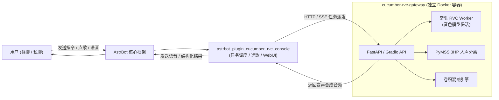

# astrbot_plugin_cucumber_rvc_console · RVC 控制台

<div align="center">


**AstrBot 现代化 AI 翻唱 + TTS 语音回复全功能控制台**

[](https://github.com/AstrBotDevs/AstrBot)
[](LICENSE)
[]()
[](https://github.com/AkinoSa/cucumber-rvc-gateway)
[]()

翻唱《歌名》→ 自动多音源检索 → 副歌智能裁剪 → 3HP 人声分离 → RVC 变声 → 卷积混响 → 语音发回群聊  
@Bot 我想听你说… → 人格情绪文本生成 + 角色台词经 TTS → RVC 变声拟人输出


</div>

> [!NOTE]
> 本插件为纯调度与交互端，模型推理、人声分离等重型任务由独立部署的 **[cucumber-rvc-gateway](https://github.com/AkinoSa/cucumber-rvc-gateway)** 推理网关（Docker 镜像开箱即用）承载。  
> 项目派生自 [sdfsfsk/matsuko_cover](https://github.com/sdfsfsk/matsuko_cover)，针对 NAS/家用服务器进行了深度重构与性能优化。

---

## 💡 这是什么

一个面向 [AstrBot](https://github.com/AstrBotDevs/AstrBot) 生态打造的开箱即用 AI 音乐与语音套件：

- 🎤 **群聊 AI 翻唱**：群内发送「`翻唱《晴天》`」或「`/rvc 晴天 3`」，机器人自动完成多平台搜索选歌、副歌能量裁剪、专业 3HP 人声伴奏分离、RVC 模型音色转换、卷积混响润色并以群语音形式发出；
- 🗣️ **TTS 拟人角色语音回复**：发送「`@Bot 我想听你说...`」，LLM 生成带有角色性格的情绪台词，结合 AstrBot 的 TTS 服务商生成音频并通过 RVC 变声为你配置的角色声线；
- 🎛️ **原生 WebUI 控制台**：内嵌于 AstrBot 管理面板，涵盖任务监控看板（RVC/TTS 双队列）、RVC 在线工作台、TTS 试音台、模型动态管理、8 参数专业级卷积混响调音与一键自检诊断；
- ⚡ **架构彻底解耦**：重 CPU 的音频分离与变声推理全部收敛至独立 Docker 网关，支持常驻 Worker 极速变声，CPU 实测稳定流畅，不卡顿聊天机器人主进程。

---

## 🌟 核心特性一览

| 模块 | 功能项 | 说明 |
|---|---|---|
| **歌曲检索与路由** | 多音源智能选歌 | 支持 网易云、酷狗、酷我、QQ 音乐路由，启发式评分匹配最精准音源，智能规避伴奏与试听片段 |
| | 双路获取引擎 | Meting 主路 + NodeJS 备用线路，支持自定义 Cookie 与失效告警 |
| **音频裁剪与分离** | 启发式副歌挑选 | 能量包络与停顿吸附算法，精准定位副歌高潮，杜绝前后颠倒与静音 |
| | 3HP 人声分离 | PyMSS 3_HP-Vocal-UVR 高品质人声与伴奏分离，伴奏人声偏轻自动换段重试 |
| **RVC 音色推理** | 动态模型扫描 | 网关扫描 `weights` 目录即插即用，Index 特征检索自适应，无需重启容器 |
| | 常驻 Worker 加速 | 模型预热常驻内存，免去每次 40s 的模型重复加载，空闲 10 分钟自动回收节省资源 |
| | 实时参数生效 | f0 算法、变调、检索率（index_rate）、保护清辅音（protect）等 10+ 核心参数秒级生效 |
| **空间与声学处理** | 8 参数卷积混响 | 专业级合成 IR + FFT 真实卷积（wet/dry/room/decay/damping/pre-delay/width），峰值防爆音 |
| **TTS 人格变声** | 全链路二段式回复 | AstrBot 已接入的 TTS 引擎（如 Edge TTS）负责生音，RVC 赋予灵魂音色，支持独立模型与混响 |
| **调度与稳定性** | 统一全局任务队列 | 翻唱 / TTS 独立排队与全局串行锁，防重复提交，支持 `/cover_status` 查询排队进度与手动取消 |
| | 异常降级兜底 | TTS 异常降级纯文本；网关异常支持子进程自动重试；会话隔离与隐私保护 |

---

## 🏗️ 运行架构



---

## 🚀 极速部署指南

### 第一步：启动推理网关（cucumber-rvc-gateway）

网关已发布预构建镜像至 GitHub Container Registry（GHCR），开箱即用无需自行编译：

1. **准备模型资产**（在宿主机准备一个目录存放模型文件）：
   - `weights/`：存放你的 RVC 音色模型（`.pth`）
   - `indices/`：存放对应的检索特征文件（`.index`，非必需但推荐）
   - `pymss_weights/`：3HP 人声分离模型文件（如 `3_HP-Vocal-UVR.pth`）
   - `hubert_base/`：HuBERT 基础特征提取模型
   - `rmvpe/`：RMVPE 音高检测模型

2. **拉取并运行网关**：
   ```bash
   git clone https://github.com/AkinoSa/cucumber-rvc-gateway.git
   cd cucumber-rvc-gateway
   cp .env.example .env
   # 编辑 .env，将各模型目录与工作目录映射至你的宿主机实际路径
   docker compose pull && docker compose up -d
   ```

3. **测试连通**：
   ```bash
   curl http://127.0.0.1:3333/
   # 返回 HTTP 200 即说明网关启动成功
   ```

> 详细的模型挂载与飞牛 NAS / Linux 部署图文教程，请参阅 **[Gateway 官方文档](https://github.com/AkinoSa/cucumber-rvc-gateway)**。

---

### 第二步：安装本插件

进入你的 AstrBot 部署目录：

```bash
cd AstrBot/data/plugins
git clone https://github.com/AkinoSa/astrbot_plugin_cucumber_rvc_console.git
```

或者在 [Releases](https://github.com/AkinoSa/astrbot_plugin_cucumber_rvc_console/releases) 下载源码压缩包解压至该目录。

在 AstrBot WebUI 中刷新并重载插件，依赖库（`gradio_client`、`aiohttp` 等）将自动就绪。

---

### 第三步：配置插件

进入 **AstrBot WebUI → 插件配置 → RVC 控制台**：

1. **网关地址**（`rvc_base_url`）：填写 `http://127.0.0.1:3333/`（若 AstrBot 与网关跨机或跨容器，请填写宿主机实际 IP 与端口，**必须以 `/` 结尾**）；
2. **网关工作目录**（`gateway_work_dir`）：填写网关 `.env` 中 `RVC_WORK_DIR` 的宿主机绝对路径（用于补发音频、TTS 历史回放）；
3. 发送群指令 `/刷新rvc模型`，确认能够正常列出已放置的音色。

> [!IMPORTANT]
> **使用 TTS 拟人语音回复功能**：  
> 请在 AstrBot 的「服务商配置」中添加一个类型为 **`text_to_speech`** 的服务商（推荐免费免配置 Key 的 **Edge TTS**，或音质顶级的 **fish.audio**）。  
> 插件负责调度 TTS 与 RVC 变声，若未配置 TTS 服务商，TTS 语音功能将无法合成原始音频。

---

## 📖 指令手册

### 👥 成员常用指令

| 指令 / 语法 | 示例 | 功能描述 |
|---|---|---|
| `翻唱《歌名》` | `翻唱《晴天》` | 智能搜索匹配最热版本，自动切副歌、分离人声并变声发送 |
| `翻唱歌手的歌名` | `翻唱周杰伦的晴天` | 精确匹配特定歌手与歌曲 |
| `/rvc <歌名> [升降调]` | `/rvc 晴天 3` | 精确指令翻唱，支持传入半音偏移（+3 升调，-2 降调） |
| `@Bot 我想听你说 <台词>` | `@Bot 我想听你说今天也要元气满满哦` | 结合人格 LLM 生成角色回复，经 TTS 与 RVC 变声以语音回复 |
| `@Bot 说一下 <台词>` | `@Bot 说一下欢迎新群友` | 快捷 TTS 语音朗读 |
| `/cover_status` | `/cover_status` | 查看当前正在进行的任务进度与自己在队列中的排队位置 |
| `取消翻唱任务` | `取消翻唱任务` | 取消由自己提交的排队中或执行中的任务 |
| `/本地翻唱` | 引用一条音频发 `/本地翻唱` | 直接对群内上传的语音或音频文件进行 RVC 变声处理 |

### 🛠️ 管理员管理指令

| 指令 | 说明 |
|---|---|
| `/刷新rvc模型` | 触发网关重新扫描 `weights` 目录下的新音色并同步至列表 |
| `/查看翻唱缓存` | 查看当前已缓存的伴奏、人声切片与成品占用体积 |
| `/清理翻唱缓存` | 释放已生成的中间音频切片与缓存文件 |

---

## 🖥️ WebUI 控制台导航

本插件深度集成了 AstrBot 原生扩展页面，在管理后台点击插件即可打开图形化控制台：

1. **概览看板**：实时展示 Gateway 联通状态、当前推理任务、音色模型总数与最近任务简报；
2. **任务监控**：RVC 翻唱队列与 TTS 语音队列双栏呈现，显示 task_id、耗时分解、排队状态及中断控制；
3. **RVC 在线工作台**：免输入聊天指令，在网页端直接上传音频、调节调音参数并试听变声结果；
4. **TTS 试音台**：在线输入文本、选择预设人格声线与混响，一键试听角色合成效果；
5. **模型管理**：可视化重命名音色别名、标记男女声倾向、单独为 RVC 与 TTS 勾选启用状态；
6. **音频效果（混响）**：8 参数专业卷积混响调音面板，附带试听波形与房体尺寸调节；
7. **诊断与自检**：一键检测网关连接、工作目录读写权限、音源 API 可用性与依赖完整度。

---

## 📊 实测性能基准

以下数据来自家用低功耗小主机（飞牛 fnOS，纯 CPU 环境，无独显）：

- **测试硬件**：Intel Core i5-6500 (4核4线程) / 16GB RAM / SATA SSD
- **运行环境**：AstrBot 4.29.0 / Gradio 6.31.0 / Torch 2.4.1+cpu
- **音频样本**：30 秒标准流行歌曲切片 → 25 秒变声成品

| 处理阶段 | 实测耗时 | 资源占用特征 |
|---|---|---|
| **音源获取** | 2 ~ 10 秒 | 取决于网络连接与所选音乐平台 |
| **副歌裁剪** | ~ 0.5 秒 | CPU 极轻微波动 |
| **3HP 人声伴奏分离** | ~ 60 ~ 70 秒 | 多线程 CPU 满载，内存峰值 ~2.5GB |
| **RVC 音色转换** | ~ 45 ~ 55 秒 | 常驻 Worker 命中，免模型加载 |
| **卷积混响润色** | ~ 0.2 秒 | 瞬时微秒级完成 |
| **翻唱全流程总耗时** | **约 2 分钟左右** | 全局串行队列，保证系统稳健不卡死 |
| **TTS 生成与变声** | **约 10 ~ 15 秒** | 短句即时响应，聊天体验优秀 |

---

## ❓ 常见问题排查（FAQ）

<details>
<summary><b>1. 发送「翻唱《歌名》」机器人只文字答应，但没有实际翻唱？</b></summary>

自然语言翻唱依赖 AstrBot 的 LLM 工具调用（Function Calling）能力：
1. 检查你当前使用的 LLM 模型是否支持工具调用（推荐 OpenAI GPT-4o、Claude 3.5、DeepSeek-V3 等主流模型）；
2. 亦可直接使用绝对确定的指令格式：`/rvc 歌名`，此命令完全不依赖大模型，直接触发执行。
</details>

<details>
<summary><b>2. 提示「网关连接失败」或「Gateway 无法访问」？</b></summary>

1. 确认 Docker 网关已成功运行（`docker ps` 查看容器状态是否为 Up）；
2. 检查 `rvc_base_url` 是否以 `/` 结尾（例如 `http://127.0.0.1:3333/`）；
3. 若 AstrBot 与网关分别运行在不同容器或主机，请填入局域网实际 IP，不能填 `127.0.0.1`。
</details>

<details>
<summary><b>3. TTS 变声只有文字回复，没有发出语音？</b></summary>

1. 本插件不内置 TTS 生成 API，必须在 AstrBot「服务商配置」中添加一个 `text_to_speech` 提供商（例如 Edge TTS）；
2. 检查插件高级设置中 `gateway_work_dir` 填写的路径是否与网关宿主机工作路径完全一致。
</details>

---

## 🤝 致谢与开源许可

本项目基于 **AGPL-3.0** 许可证开源，继承上游项目的开源义务与衍生授权：

- **上游核心派生**：[sdfsfsk/matsuko_cover](https://github.com/sdfsfsk/matsuko_cover)（AGPL-3.0）与 [void-HaoNan/astrbot-plugin-chorus-cover](https://github.com/void-HaoNan/astrbot-plugin-chorus-cover)；
- **上游前身探索**：[CCYellowStar2/astrbot_plugin_rvc_svc](https://github.com/CCYellowStar2/astrbot_plugin_rvc_svc)；
- **核心推理框架**：[Retrieval-based-Voice-Conversion-WebUI](https://github.com/RVC-Project/Retrieval-based-Voice-Conversion-WebUI)（MIT）；
- **人声分离核心**：[PyMSS / MSST-WebUI](https://github.com/SUC-DriverOld/MSST-WebUI) 系 3HP 模型；
- **机器人底层驱动**：[AstrBot](https://github.com/AstrBotDevs/AstrBot) 机器人框架。

特别鸣谢所有开源社区贡献者的持续付出！
